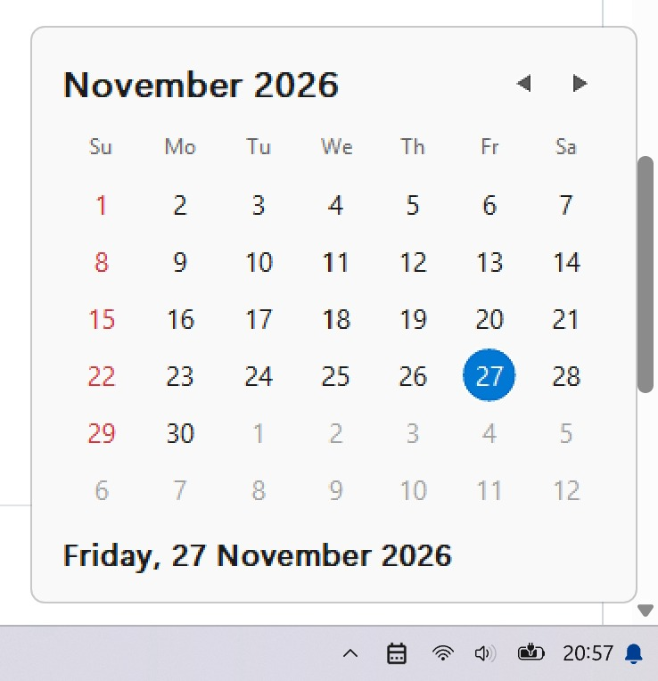
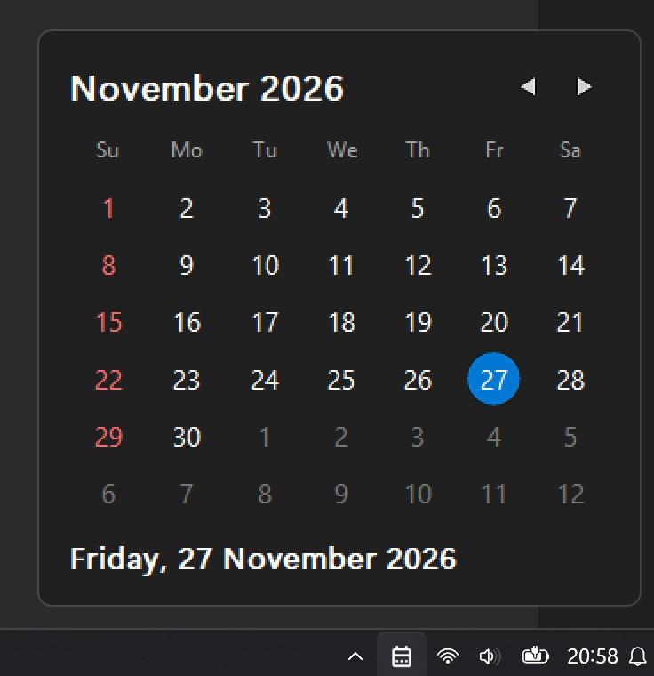

# CalendarFlyout

**A simple, lightweight calendar for Windows 11.**

A convenient way to check dates without opening a browser or a separate calendar application. CalendarFlyout brings a clean monthly calendar right to your Windows taskbar.

- Quick access whenever you need it.
- Simple navigation between months.
- A clean interface that fits your Windows desktop.
- No account, login, or internet connection required for basic calendar functionality.

  
  

---

## Table of Contents

- [🇮🇩 Bahasa Indonesia](#-bahasa-indonesia)
  - [Tentang CalendarFlyout](#tentang-calendarflyout)
  - [Mengapa Menggunakan CalendarFlyout?](#mengapa-menggunakan-calendarflyout)
  - [Fitur](#fitur)
  - [Cara Menggunakan](#cara-menggunakan)
  - [Pengaturan](#pengaturan)
  - [FAQ](#faq)
- [🇬🇧 English](#-english)
  - [About CalendarFlyout](#about-calendarflyout)
  - [Why CalendarFlyout?](#why-calendarflyout)
  - [Features](#features)
  - [How to Use](#how-to-use)
  - [Settings](#settings)
  - [FAQ](#faq-1)
- [License](#license)

---

# 🇮🇩 Bahasa Indonesia

## Tentang CalendarFlyout

CalendarFlyout adalah aplikasi kalender sederhana untuk Windows 11 yang bisa dibuka langsung dari ikon kecil di sebelah jam pada taskbar.

Tidak perlu membuka browser atau aplikasi kalender terpisah. Cukup klik ikon CalendarFlyout untuk melihat kalender bulanan kapan saja.

Dirancang agar praktis, ringan, dan mudah digunakan oleh siapa saja.

## Mengapa Menggunakan CalendarFlyout?

- **Lebih praktis:** Periksa tanggal tanpa harus membuka aplikasi atau browser lain.
- **Akses lebih cepat:** Kalender tersedia langsung dari taskbar Windows.
- **Mudah digunakan:** Tampilan sederhana dengan navigasi bulan yang intuitif.
- **Nyaman dilihat:** Mendukung tema terang dan gelap.
- **Siap digunakan setiap saat:** Bisa diatur agar otomatis berjalan ketika Windows dinyalakan.
- **Tidak bergantung pada internet:** Kalender dasar tetap berfungsi secara offline.

## Fitur

| Fitur | Manfaat |
|---|---|
| Kalender Bulanan | Melihat susunan tanggal dalam satu bulan dengan mudah. |
| Navigasi Bulan | Berpindah ke bulan sebelumnya atau berikutnya. |
| Penanda Hari Ini | Mengetahui tanggal hari ini dengan cepat. |
| Tema Terang & Gelap | Menyesuaikan tampilan dengan preferensi dan tema Windows. |
| Akses dari Taskbar | Membuka kalender langsung dari ikon di dekat jam Windows. |
| Buka dengan Arahkan Kursor | Kalender dapat terbuka otomatis ketika kursor diarahkan ke ikon aplikasi. |
| Jalankan Otomatis | Aplikasi dapat berjalan sendiri ketika Windows dinyalakan. |

## Cara Menggunakan

**1. Download**

Buka [CalendarFlyout Releases](https://github.com/sholihdinrizky/CalenderFluentWindows/releases), kemudian unduh versi terbaru.

**2. Ekstrak File**

Klik kanan file ZIP yang sudah diunduh, lalu pilih **Extract All**.

**3. Jalankan Aplikasi**

Buka folder hasil ekstraksi, kemudian klik dua kali `CalendarFlyout.exe`.

**4. Buka Kalender**

Cari ikon CalendarFlyout di sebelah jam pada taskbar Windows. Klik ikon tersebut untuk membuka kalender.

Selesai! Sekarang kamu bisa mengecek tanggal dengan lebih praktis.

## Pengaturan

Klik kanan ikon CalendarFlyout untuk menemukan beberapa pilihan:

| Pengaturan | Penjelasan |
|---|---|
| Open Calendar | Membuka kalender secara manual dengan mengeklik pilihan ini. |
| Show on Hover | Membuka kalender secara otomatis ketika kursor diarahkan ke ikon aplikasi. |
| Run at Startup | Menjalankan CalendarFlyout secara otomatis setiap kali Windows dinyalakan. |
| Exit | Menutup aplikasi CalendarFlyout. |

Kamu bisa mengaktifkan atau menonaktifkan fitur sesuai kebutuhan.

## FAQ

**Apakah CalendarFlyout gratis?**

Ya. CalendarFlyout merupakan proyek open-source yang dapat digunakan secara gratis dengan lisensi MIT.

**Apakah membutuhkan koneksi internet?**

Tidak. Fungsi kalender dasar dapat digunakan tanpa koneksi internet.

**Apakah harus menginstal aplikasi tambahan?**

Tidak diperlukan instalasi aplikasi kalender tambahan. Cukup unduh, ekstrak, dan jalankan file aplikasi yang tersedia.

**Apakah aplikasi akan otomatis terbuka ketika komputer dinyalakan?**

Bisa. Aktifkan pilihan **Run at Startup** melalui menu klik kanan ikon CalendarFlyout.

**Bagaimana cara menghapus aplikasi?**

Pilih **Exit** melalui menu klik kanan ikon aplikasi, kemudian hapus file atau folder CalendarFlyout.

---

# 🇬🇧 English

## About CalendarFlyout

CalendarFlyout is a simple calendar application for Windows 11 that can be opened directly from the small icon area next to the taskbar clock.

No need to open a browser or a separate calendar application. Simply click the CalendarFlyout icon to view your monthly calendar whenever you need it.

Designed to be practical, lightweight, and easy for everyone to use.

## Why CalendarFlyout?

- **More convenient:** Check dates without opening another application or browser.
- **Quick access:** Open your calendar directly from the Windows taskbar.
- **Easy to use:** A simple interface with intuitive month navigation.
- **Comfortable viewing:** Supports both light and dark themes.
- **Always ready:** Can launch automatically when Windows starts.
- **Works offline:** Basic calendar functionality does not require an internet connection.

## Features

| Feature | Benefit |
|---|---|
| Monthly Calendar | View all dates in a month at a glance. |
| Month Navigation | Move between previous and next months. |
| Today Indicator | Quickly identify today's date. |
| Light & Dark Themes | Match your preferred appearance and Windows theme. |
| Taskbar Access | Open your calendar directly from the Windows taskbar. |
| Open on Hover | Automatically open the calendar when hovering over its icon. |
| Automatic Startup | Launch CalendarFlyout automatically when Windows starts. |

## How to Use

**1. Download**

Visit [CalendarFlyout Releases](https://github.com/sholihdinrizky/CalenderFluentWindows/releases) and download the latest version.

**2. Extract the File**

Right-click the downloaded ZIP file and select **Extract All**.

**3. Run the Application**

Open the extracted folder and double-click `CalendarFlyout.exe`.

**4. Open the Calendar**

Find the CalendarFlyout icon next to the clock on your Windows taskbar. Click the icon to open your calendar.

That's it! You can now check dates more conveniently.

## Settings

Right-click the CalendarFlyout icon to access these options:

| Setting | Description |
|---|---|
| Open Calendar | Manually open the calendar by selecting this option. |
| Show on Hover | Automatically open the calendar when hovering over the application icon. |
| Run at Startup | Automatically launch CalendarFlyout whenever Windows starts. |
| Exit | Close the CalendarFlyout application. |

You can enable or disable these options according to your preferences.

## FAQ

**Is CalendarFlyout free?**

Yes. CalendarFlyout is a free, open-source project distributed under the MIT License.

**Does it require an internet connection?**

No. Basic calendar functionality works offline.

**Do I need to install additional applications?**

No additional calendar application is required. Simply download, extract, and run the provided application.

**Will the application start automatically when I turn on my computer?**

Yes, if you enable **Run at Startup** from the CalendarFlyout right-click menu.

**How do I uninstall it?**

Select **Exit** from the application's right-click menu, then delete the CalendarFlyout file or folder.

---

## License

Distributed under the [MIT License](LICENSE).
